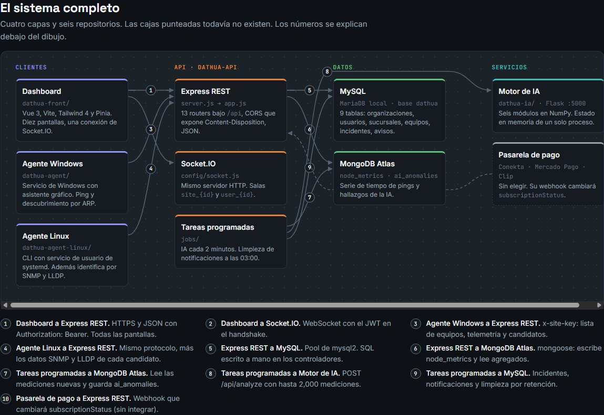
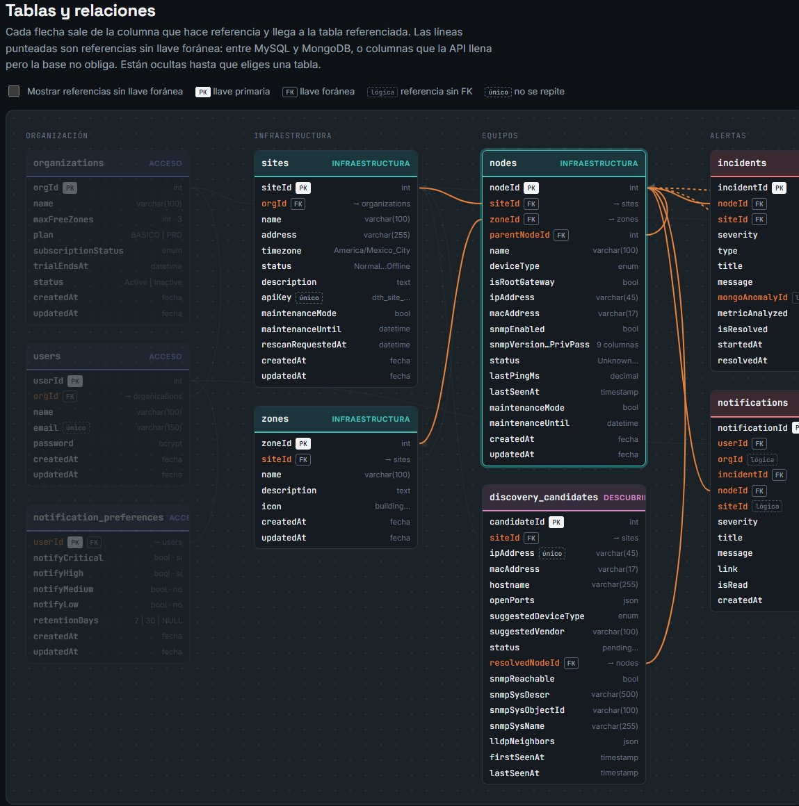

# DatHua

**Network monitoring SaaS for small and medium businesses.** DatHua detects network failures before they stop the business, and explains them in plain language.

I lead the project and program it end to end: requirements, architecture, development and technical documentation.

> Public portfolio version of a private repository. Secrets, internal notes and business documents were removed and the history starts fresh. Code comments and docs are in Spanish.

<p align="center"></p>

## Architecture

```
 Windows agent (.exe, Windows Service) ─┐
 Linux agent (systemd user service)  ───┼──► REST API (Node.js / Express 5) ──► MySQL  (accounts, sites, nodes, incidents)
                                        │        │  Socket.IO (real time)    └► MongoDB (time-series metrics)
 Vue 3 dashboard ◄──────────────────────┘        └──► Python analysis engine (anomaly detection)
```

<p align="center"></p>

| Folder | What it is | Stack |
| --- | --- | --- |
| [`dathua-api`](dathua-api) | Multi-tenant REST API, ~60 endpoints, JWT auth, rate limiting, scheduled jobs, PDF reports | Node.js, Express 5, MySQL, MongoDB, Socket.IO, node-cron |
| [`dathua-agent`](dathua-agent) | Windows agent: runs as a Windows Service with a setup GUI, monitors devices over ICMP and SNMP, discovers the network | Python, pywin32, customtkinter, pysnmp, PyInstaller |
| [`dathua-agent-linux`](dathua-agent-linux) | Linux agent: same protocol, runs as a systemd user service with `loginctl enable-linger`; developed on Arch Linux | Python, systemd, iproute2, pysnmp |
| [`dathua-ia`](dathua-ia) | Analysis pipeline: preprocessing, EWMA / CUSUM / percentile detectors, seasonality, incident prioritization | Python |
| [`dathua-front`](dathua-front) | Dashboard: sites, zones, nodes, incidents, real-time updates, PDF/CSV reports | Vue 3, Pinia, Vue Router, Tailwind |
| [`dathua-landing`](dathua-landing) | Marketing site | Vue 3, Tailwind |
| [`docs`](docs) | Interactive data map and API architecture docs (open the HTML files in a browser) | HTML |

## Engineering highlights

- **Multi-tenant by design:** every query is scoped to the organization in the JWT; emails are unique per organization, not globally.
- **Two OS-native agents** instead of one cross-platform compromise: a Windows Service and a systemd user unit, sharing the same API protocol.
- **Automated tests** with pytest for both agents, several of them against the real system without root.
- **Anomaly detection** combining EWMA, CUSUM and percentiles so alerts fire on real degradation, not on noise.
- **Security basics:** bcrypt password hashing, JWT with 24 h expiry, login rate limiting, no secrets in the repository (see `.env.example`).
- **Versioned SQL migrations** in [`dathua-api/migrations`](dathua-api/migrations) and the full schema in [`dathua_schema_final.sql`](dathua_schema_final.sql).

<p align="center"></p>

## Running it locally

```bash
# API
cd dathua-api && cp .env.example .env   # fill in your MySQL / MongoDB values
npm install && npm run dev

# Dashboard
cd dathua-front && npm install && npm run dev

# Linux agent
cd dathua-agent-linux && python -m venv .venv && . .venv/bin/activate
pip install -r requirements.txt && python -m agent_linux setup --url http://localhost:3000/api --key <site-key>
python -m agent_linux install   # creates the systemd user service
```

## Team

DatHua is a team project. I lead it and program it end to end; teammates contributed in AI / data, software engineering and sales / networking.

## License

All rights reserved. The code is published so it can be read and evaluated; see [LICENSE](LICENSE).
